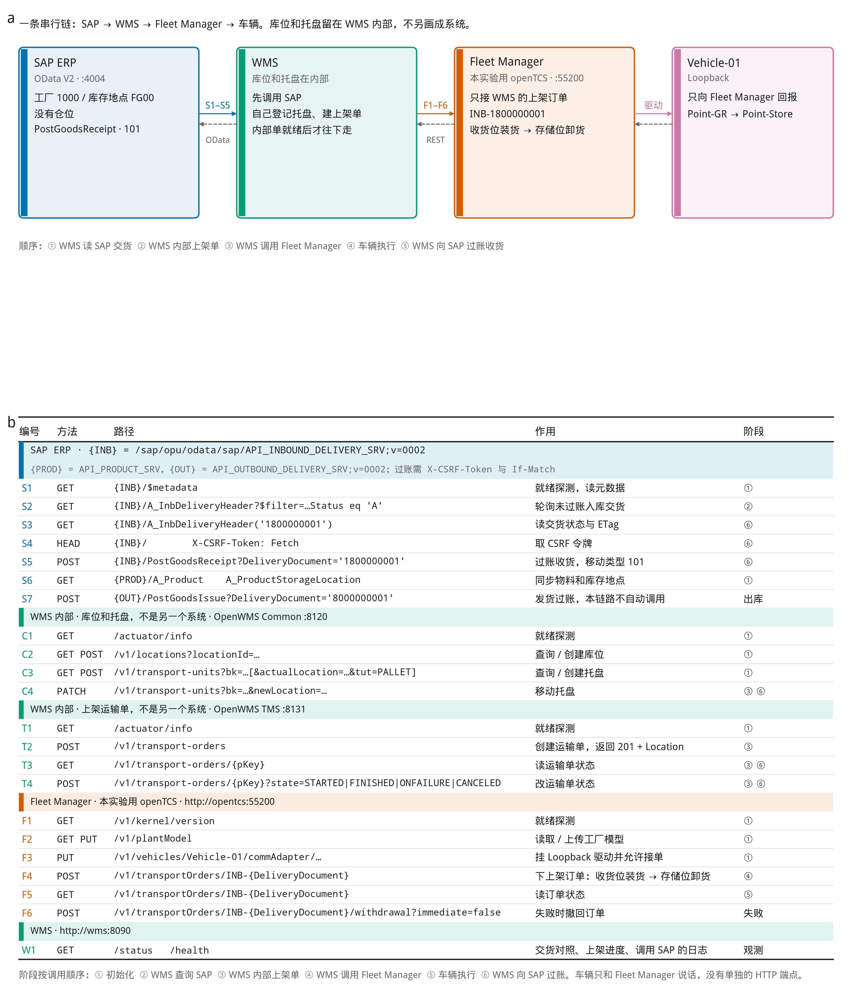
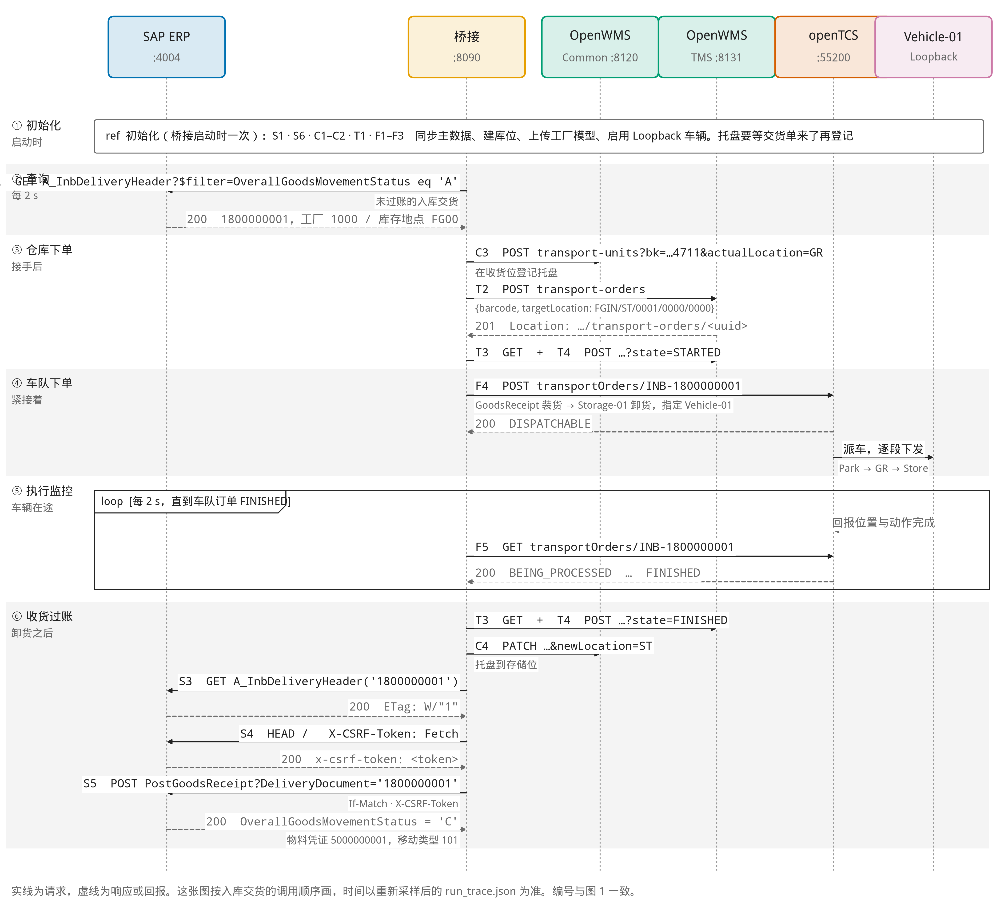
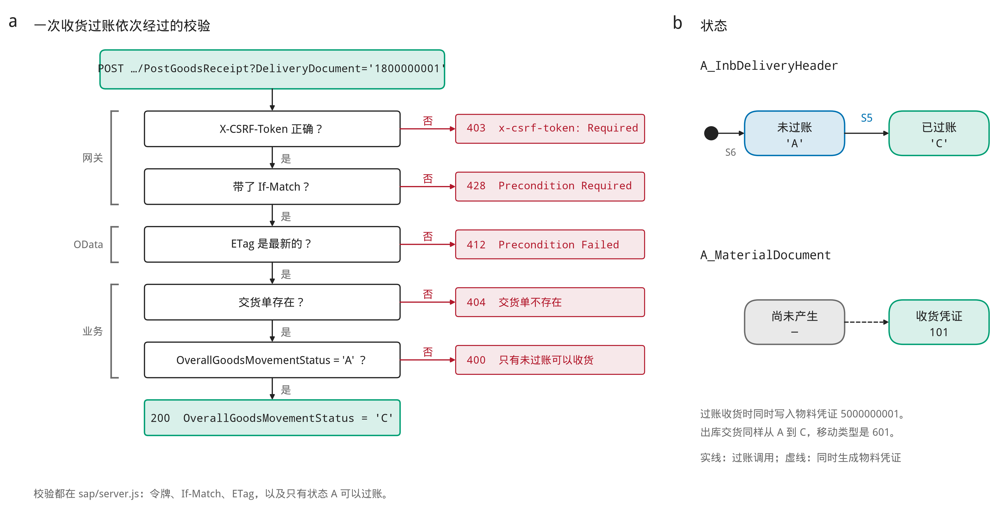
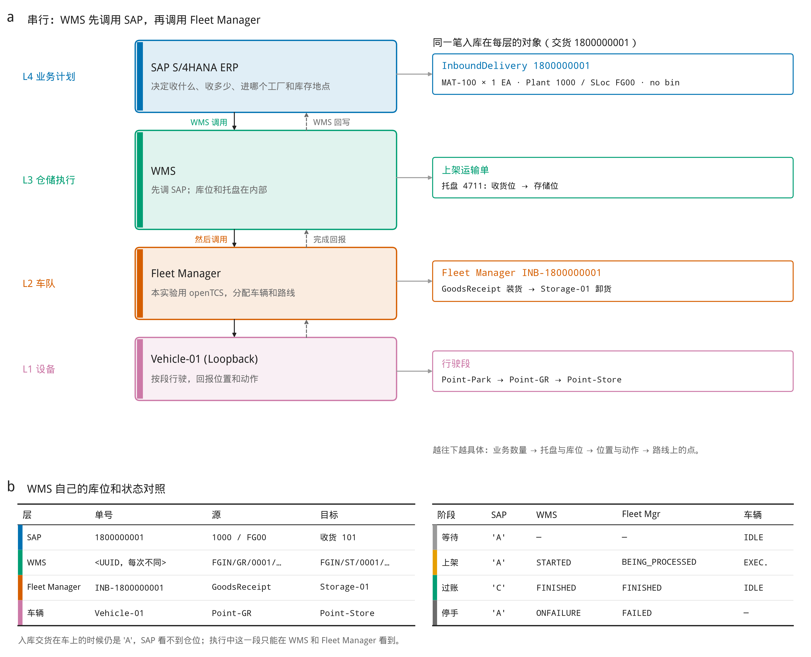

# SAP ERP 加独立 WMS

下面四张图是入库交货 `1800000001` 的结果。SAP 只认工厂 `1000` 和库存地点 `FG00`。仓位、托盘和上架在 OpenWMS。车队把货从收货位送到存储位，完成后 SAP 按移动类型 `101` 过账收货。

原图、英文版、PDF 和 SVG 在 [docs/sap-erp-wms](docs/sap-erp-wms/README.md)。

## 图 1 接口

## 图 2 时序

## 图 3 收货过账

## 图 4 架构

