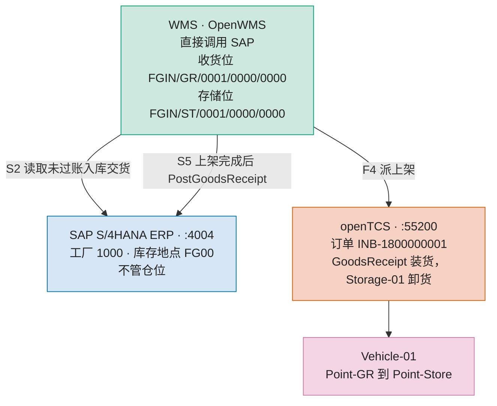
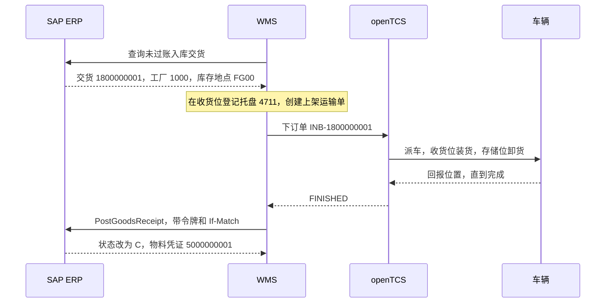
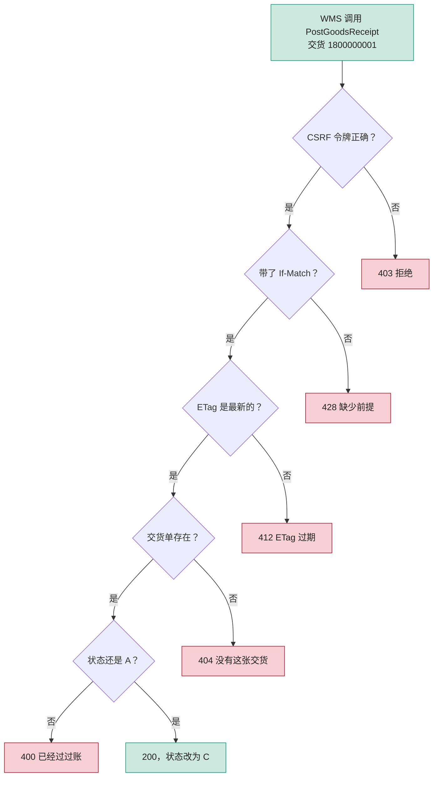
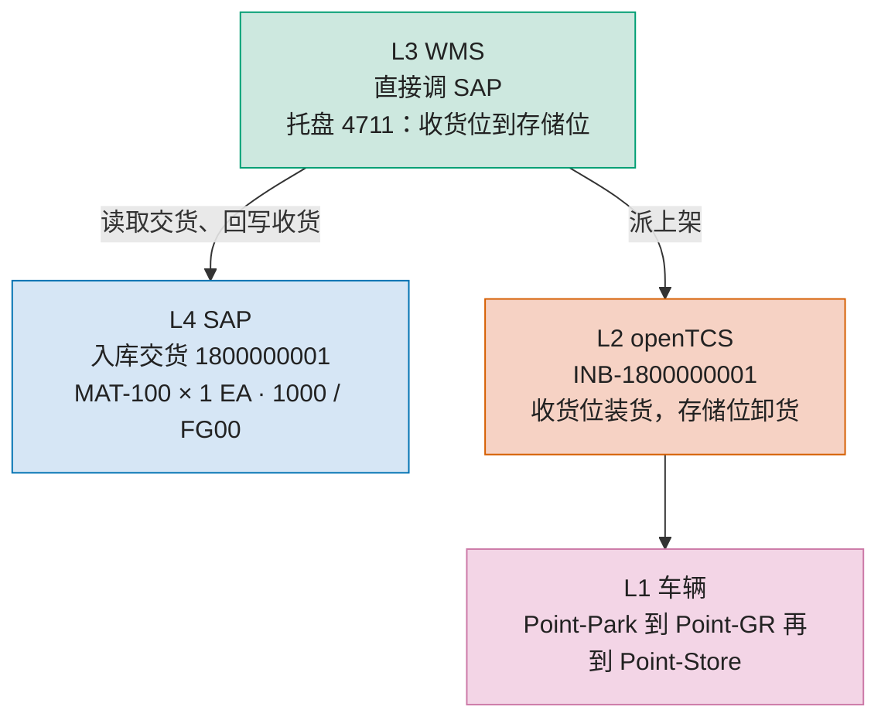

# SAP ERP 加独立 WMS

没有桥接。WMS 直接调用 SAP。

入库交货 `1800000001`：SAP 只认工厂 `1000` 和库存地点 `FG00`。库位、托盘和上架在 WMS。WMS 向车队派车，车从收货位送到存储位之后，WMS 再调用 SAP 过账收货，移动类型 `101`，物料凭证 `5000000001`。

往下拉过文件列表就能看到图。这些图直接画在页面上。

## 调用方向

## 图 1 时序

## 图 2 收货过账

WMS 调用 `PostGoodsReceipt` 时，SAP 按这个顺序检查。有一项不通过就不改交货单。

货在车上的时候，SAP 交货仍是 `A`。SAP 看不到仓位。

## 图 3 分层

| 阶段 | SAP | WMS | openTCS | 车辆 |
| --- | --- | --- | --- | --- |
| 等待 | A | 还没有单 | 还没有单 | IDLE |
| 上架 | A | STARTED | BEING_PROCESSED | 执行中 |
| 过账 | C | FINISHED | FINISHED | IDLE |
| 停手 | A | ONFAILURE | FAILED | 停 |

高清原图

[接口](docs/sap-erp-wms/fig1_interfaces_zh.png) · [时序](docs/sap-erp-wms/fig2_sequence_zh.png) · [收货过账](docs/sap-erp-wms/fig3_confirm_zh.png) · [架构](docs/sap-erp-wms/fig4_architecture_zh.png)

同目录还有英文版、PDF 和 SVG。

