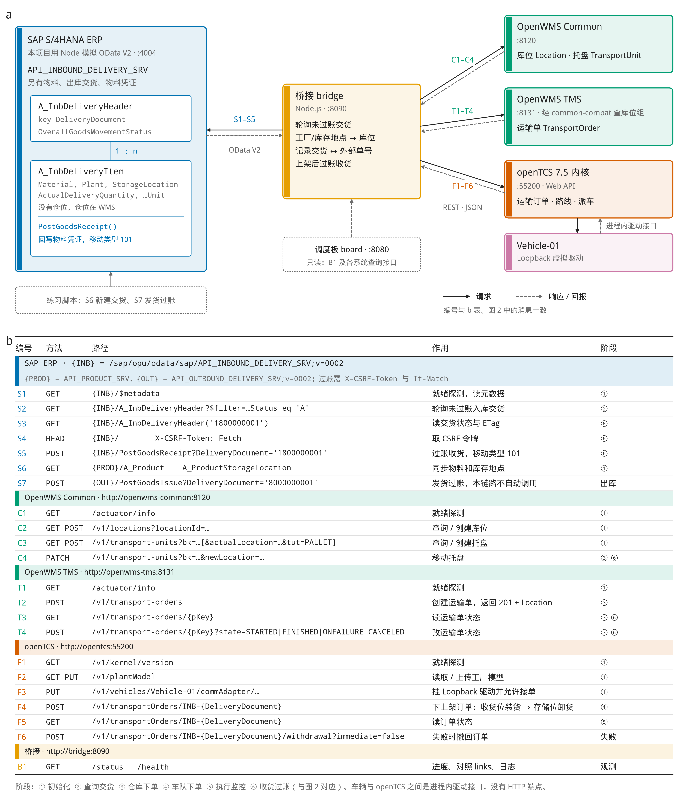
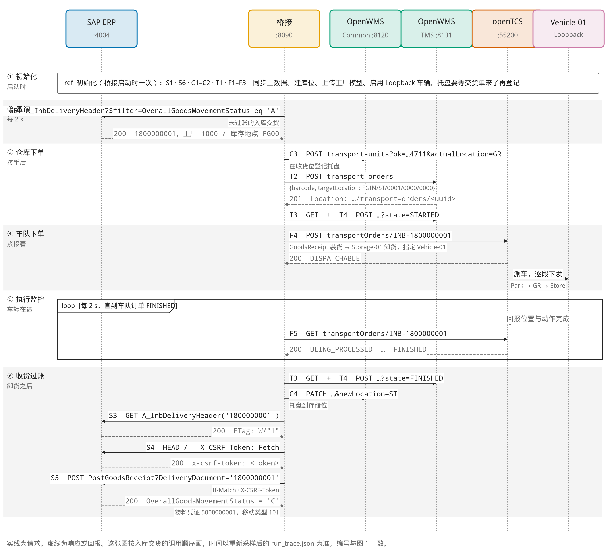
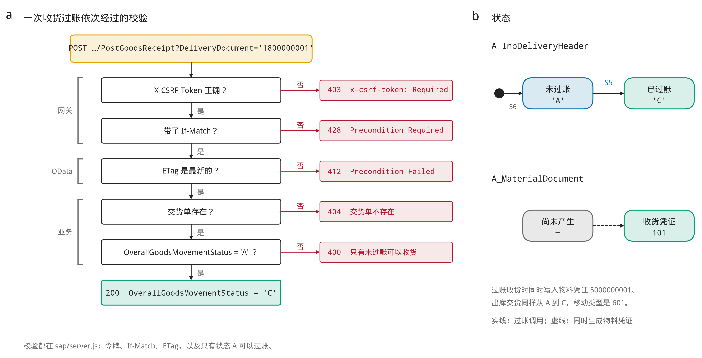
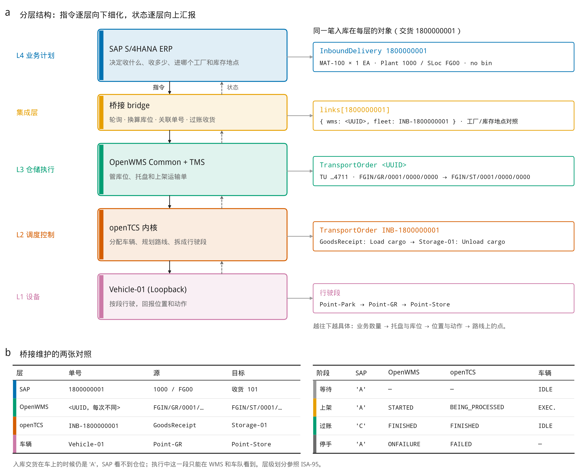

# SAP ERP 加独立 WMS

这四张图是入库交货 `1800000001` 的结果：SAP 只认工厂 `1000` 和库存地点 `FG00`，仓位、托盘和上架在 OpenWMS，车队把货从收货位送到存储位，完成后 SAP 按移动类型 `101` 过账收货。

同目录里还有英文版，以及 PDF、SVG。文件名以 `_zh` 结尾的是中文，以 `_en` 结尾的是英文。

运行状态图没有放进来。那张仍是改架构之前按 EWM 仓库任务采样的，不能对照这四张。

## 图 1 接口

## 图 2 时序

## 图 3 收货过账

## 图 4 架构

