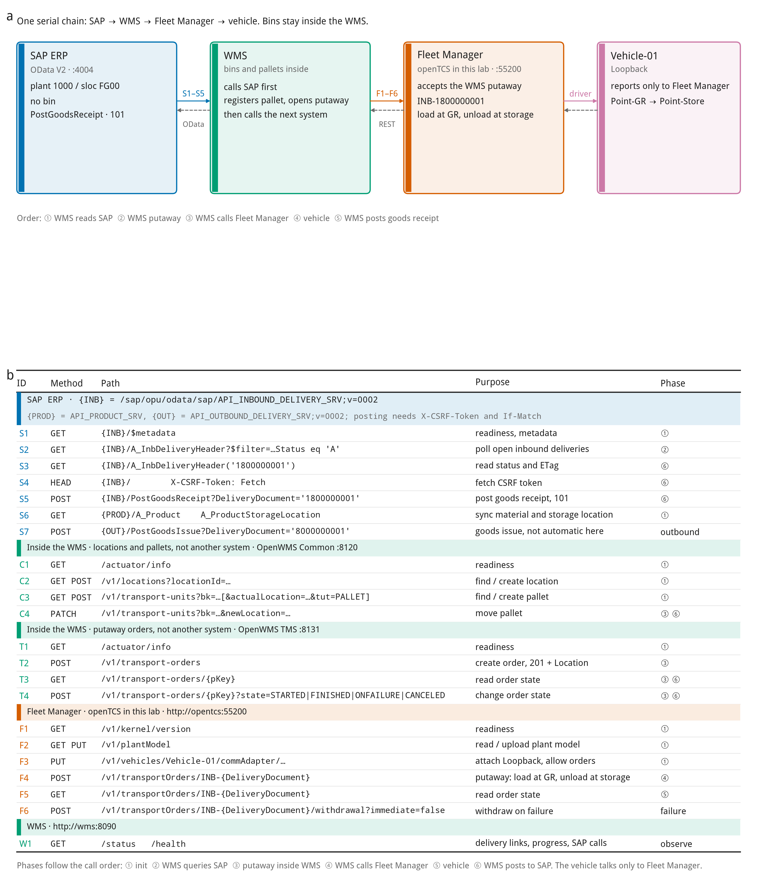
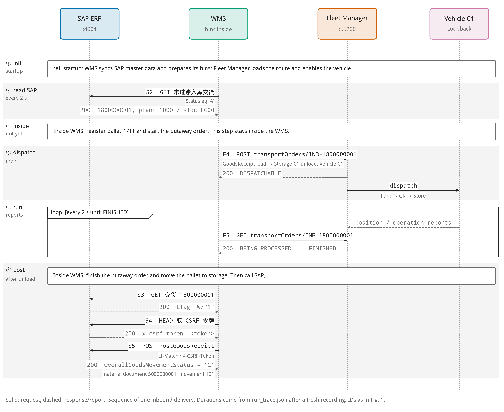
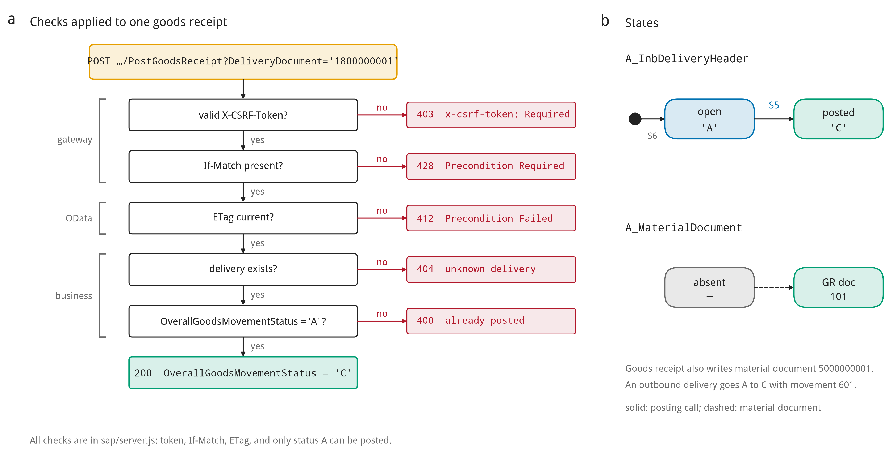
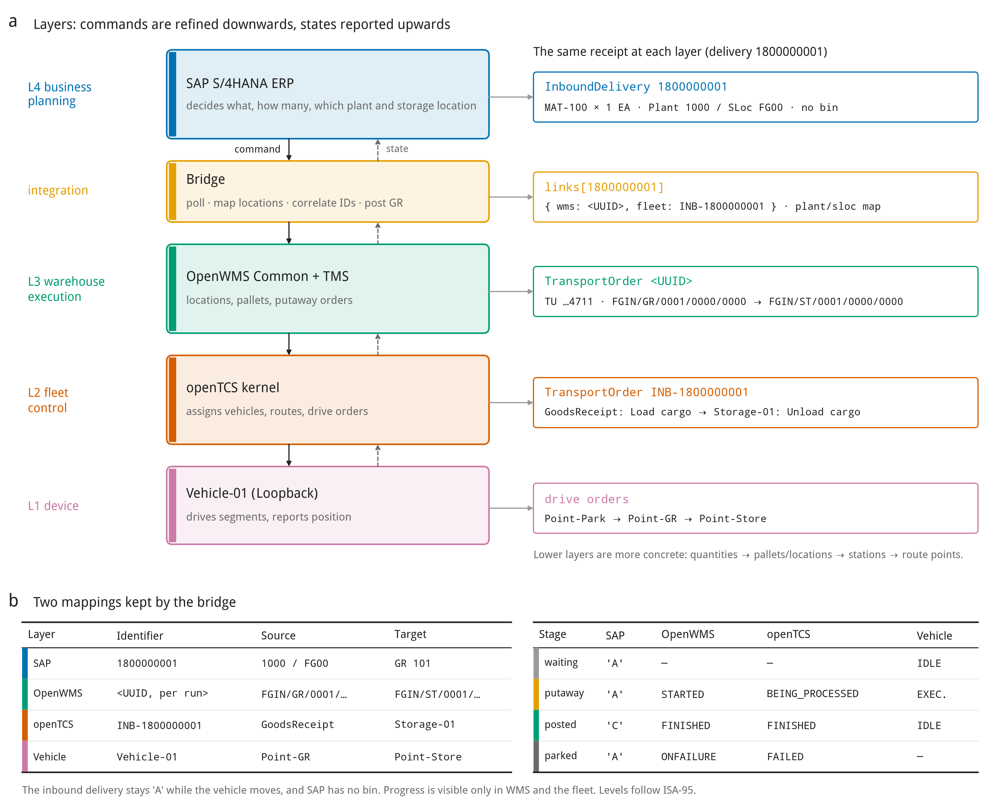

# SAP ERP 加独立 WMS

本目录四张图和仓库首页 README 的图 1 到图 4 是同一套。这里直接显示英文图。中文文件名把 `_en` 换成 `_zh`，另外各有 PDF 和 SVG。要在另一台电脑跑容器，按首页的「下载并运行」，进入 `sap-wms-fleet` 后执行 `docker compose up --build -d`。

入库交货 `1800000001`。调用顺序是 SAP，然后 WMS，然后 Fleet Manager，然后车辆。库位和托盘在 WMS 内部。Fleet Manager 这一层本实验用 openTCS。

## 图 1 接口

从左到右：SAP ERP、WMS、Fleet Manager、Vehicle-01。WMS 先调用 SAP，内部上架单就绪后才调用 Fleet Manager。

## 图 2 时序

② 读 SAP 交货，③ WMS 内部登记托盘，④ 调用 Fleet Manager，⑤ 车辆回报，⑥ WMS 向 SAP 过账收货。

## 图 3 收货过账

`PostGoodsReceipt` 的校验链，以及交货单从 `A` 到 `C`、物料凭证移动类型 `101`。

## 图 4 架构

L4 SAP、L3 WMS、L2 Fleet Manager、L1 车辆，以及单号和状态对照。
