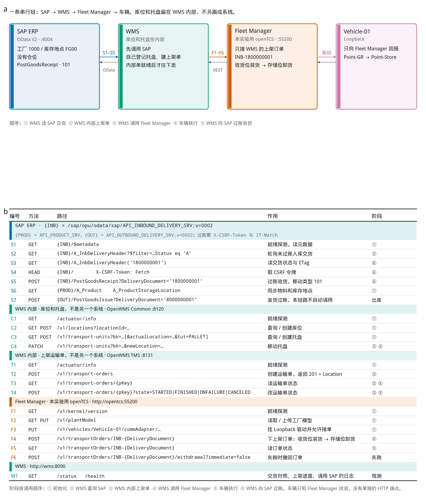
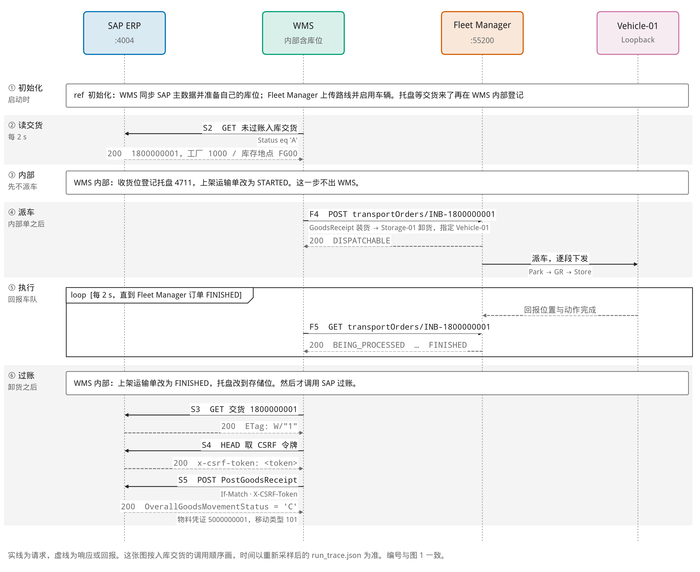
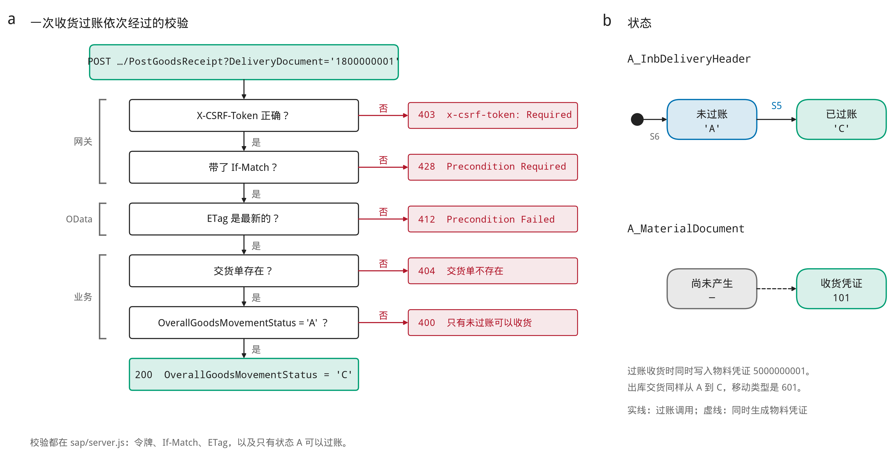

# 在本机学习 SAP ERP 加独立 WMS

完整版里的 SAP（端口 4004）模拟的是 S/4HANA 作为 ERP、旁边接独立 WMS 时用到的标准接口。这一版不模拟 EWM 的 `API_WAREHOUSE_ORDER_TASK_2`。仓位不在 SAP 里。WMS 自己完成收货和上架，然后再串行调用 Fleet Manager，做完再回写收货过账。

不需要公司的测试系统。`docker compose up --build -d` 之后，下面每一步都能在本机 PowerShell 里执行。

先设好四个服务地址：

```powershell
$prod = 'http://localhost:4004/sap/opu/odata/sap/API_PRODUCT_SRV'
$inb  = 'http://localhost:4004/sap/opu/odata/sap/API_INBOUND_DELIVERY_SRV;v=0002'
$outb = 'http://localhost:4004/sap/opu/odata/sap/API_OUTBOUND_DELIVERY_SRV;v=0002'
$mat  = 'http://localhost:4004/sap/opu/odata/sap/API_MATERIAL_DOCUMENT_SRV'
```

协议是 OData V2，集合在 `d.results` 里。本模拟把日期写成 `YYYY-MM-DD`，数量写成三位小数字符串。真实网关的日期常是 `/Date(…)/`。全服务共用一个 CSRF 令牌；真实系统要按服务分别取，并且和 cookie 绑在一起。没有登录。

## 图

下面三张图在 `docs/figures/`，每张有 PDF、SVG 和 600 dpi PNG。改了接口以后，在该目录执行 `python make_figures.py` 重新生成（需要 matplotlib）。

**图 1 系统与接口总览。** a 是各系统和它们之间的接口，b 是方法、路径和用途。



**图 2 入库交货 1800000001 的调用时序。**



**图 3 收货过账的校验链和交货单状态。**



## 最小的六组接口

采购入库加上销售出库，至少是这六组。这一版自动跑通的是前四组里的入库方向；出库两组接口可以调用，WMS 不自动拣货。

| 接口组 | 方向 | 本模拟里的服务和对象 | 主要用途 |
| --- | --- | --- | --- |
| 物料主数据 | SAP → WMS | `API_PRODUCT_SRV` / `A_Product`、`A_ProductUnitsOfMeasure` | 同步物料、单位 |
| 工厂和库存地点 | SAP → WMS | `A_ProductPlant`、`A_ProductStorageLocation` | 建立 SAP 组织与 WMS 库位的映射 |
| 入库交货 | SAP → WMS | `API_INBOUND_DELIVERY_SRV` / `A_InbDeliveryHeader`、`A_InbDeliveryItem` | 把预计到货交给 WMS |
| 收货结果 | WMS → SAP | `PostGoodsReceipt`，以及 `API_MATERIAL_DOCUMENT_SRV` | WMS 上架后在 SAP 过账，移动类型 `101` |
| 出库交货 | SAP → WMS | `API_OUTBOUND_DELIVERY_SRV` / `A_OutbDeliveryHeader` | 把发货需求交给 WMS |
| 发货结果 | WMS → SAP | `PostGoodsIssue`，以及物料凭证 | WMS 发货后在 SAP 过账，移动类型 `601` |

货物移动状态沿用交货单：`A` 未过账，`C` 已过账。过账后的物料凭证号写在交货单的 `MaterialDocument` 上，方便在本模拟里直接看到。真实系统通常要再去物料凭证服务里查，抬头不一定带回这个字段。

## 和真实接口对齐的地方

| 项目 | 值 |
| --- | --- |
| 物料 | `API_PRODUCT_SRV`，实体 `A_Product`、`A_ProductPlant`、`A_ProductStorageLocation`、`A_ProductUnitsOfMeasure` |
| 入库交货 | `API_INBOUND_DELIVERY_SRV;v=0002`，实体 `A_InbDeliveryHeader`、`A_InbDeliveryItem` |
| 入库过账 | 函数导入 `PostGoodsReceipt`，参数 `DeliveryDocument` |
| 出库交货 | `API_OUTBOUND_DELIVERY_SRV;v=0002`，实体 `A_OutbDeliveryHeader`、`A_OutbDeliveryItem` |
| 出库过账 | 函数导入 `PostGoodsIssue`，参数 `DeliveryDocument` |
| 物料凭证 | `API_MATERIAL_DOCUMENT_SRV`，实体 `A_MaterialDocumentHeader`、`A_MaterialDocumentItem` |
| 收货移动类型 | `101`，抬头 `GoodsMovementCode` = `01` |
| 发货移动类型 | `601`，抬头 `GoodsMovementCode` = `03` |
| 写操作前 | 先 `HEAD` 带 `X-CSRF-Token: Fetch`，过账再带 `If-Match` |

模拟时少做的部分：没有深导航的延迟加载，读交货单时直接带出行；没有认证；CSRF 不绑 cookie；物料凭证抬头上的 `ReferenceDocument` 是为了能 `$filter`，标准字段在行上。接真实系统前用对方的 `$metadata` 核对。

## 一步一步调用

### 1. 看物料和库存地点

WMS 启动时先做这两句，对应主数据同步：

```powershell
(Invoke-RestMethod "$prod/A_Product").d.results |
  Format-Table Product, ProductType, BaseUnit
(Invoke-RestMethod "$prod/A_ProductStorageLocation").d.results |
  Format-Table Product, Plant, StorageLocation
```

预制的是物料 `MAT-100`（`HAWA`，基本单位 `EA`），工厂 `1000`，库存地点 `FG00`。

### 2. 查未过账的入库交货

WMS 轮询的就是这一句，每 2 秒查一次：

```powershell
(Invoke-RestMethod "$inb/A_InbDeliveryHeader?`$filter=OverallGoodsMovementStatus eq 'A'").d.results |
  Format-Table DeliveryDocument, Supplier, OverallGoodsMovementStatus
```

刚启动时能看到 `1800000001`。等 WMS 跑完，它就不在这个列表里了。行在 `to_DeliveryDocumentItem.results`，物料、工厂、库存地点、数量都在行上。SAP 不给仓位。

### 3. 读单张交货，拿到 ETag

```powershell
$one = Invoke-WebRequest "$inb/A_InbDeliveryHeader('1800000001')" -UseBasicParsing
$one.Headers['ETag']
```

ETag 形如 `W/"1"`，过账一次就变一次。

### 4. 取 CSRF 令牌

```powershell
$token = (Invoke-WebRequest -Method Head -Uri "$inb/" -Headers @{ 'X-CSRF-Token' = 'Fetch' } -UseBasicParsing).Headers['x-csrf-token']
```

不带令牌的写请求返回 403，响应头是 `x-csrf-token: Required`。

### 5. 新建一张入库交货

```powershell
$new = Invoke-RestMethod -Method Post -Uri "$inb/A_InbDeliveryHeader" -ContentType 'application/json' `
  -Headers @{ 'X-CSRF-Token' = $token } `
  -Body '{"Supplier":"V200","to_DeliveryDocumentItem":{"results":[{"Material":"MAT-100","Plant":"1000","StorageLocation":"FG00","ActualDeliveryQuantity":2,"DeliveryQuantityUnit":"EA"}]}}'
$new.d.DeliveryDocument
```

返回 201，交货单号由 SAP 分配。WMS 会接手，上架后把它过账。真实系统里入库交货通常由采购订单收货产生，这里开放新建是为了练习。

### 6. 过账收货

这是 WMS 上架完成后调用的一步。对一张还没过账的交货：

```powershell
$key = $new.d.DeliveryDocument
$etag = (Invoke-WebRequest "$inb/A_InbDeliveryHeader('$key')" -UseBasicParsing).Headers['ETag']
Invoke-RestMethod -Method Post -Uri "$inb/PostGoodsReceipt?DeliveryDocument='$key'" -ContentType 'application/json' `
  -Headers @{ 'X-CSRF-Token' = $token; 'If-Match' = $etag } -Body '{}'
```

成功后 `OverallGoodsMovementStatus` 为 `C`，响应里有 `MaterialDocument`。物料凭证也可以单独查：

```powershell
(Invoke-RestMethod "$mat/A_MaterialDocumentItem?`$filter=ReferenceDocument eq '1800000001'").d.results |
  Format-Table MaterialDocument, GoodsMovementType, Material, Plant, StorageLocation, QuantityInEntryUnit
```

移动类型是 `101`。WMS 通常会抢先过账，手动练这一步时可以先 `docker compose stop wms`，练完再 `docker compose start wms`。

### 7. 故意出错

| 改法 | 返回 | 说明 |
| --- | --- | --- |
| 去掉 `X-CSRF-Token` | 403，`x-csrf-token: Required` | 先做第 4 步 |
| 去掉 `If-Match` | 428 | 过账必须带 ETag |
| `If-Match` 用旧的 ETag | 412 | 别人刚改过，重新读一次 |
| 对已过账的交货再过账 | 400 | 只有状态 `A` 可以过账 |

### 8. 出库交货和发货过账

预制出库交货 `8000000001`，类型 `LF`，送达方 `C100`，同一颗物料、同一个工厂和库存地点，移动类型 `601`。WMS 不接手它。

```powershell
$etag = (Invoke-WebRequest "$outb/A_OutbDeliveryHeader('8000000001')" -UseBasicParsing).Headers['ETag']
Invoke-RestMethod -Method Post -Uri "$outb/PostGoodsIssue?DeliveryDocument='8000000001'" `
  -Headers @{ 'X-CSRF-Token' = $token; 'If-Match' = $etag } -Body '{}'
```

这只证明 SAP 侧的发货过账接口。真实集成里要先在 WMS 拣货、装车，再调用它。本模拟的 `PostGoodsIssue` 不检查仓库是否已经拣完。

也可以不调用函数导入，改向物料凭证服务过账，行上的 `ReferenceDocument` 指向交货单，`GoodsMovementCode` 用 `01` 或 `03`。交货单仍是 `A` 时，效果和上面两个函数导入一样。

## WMS 按什么顺序调用 SAP

`wms/index.js` 里和 SAP 有关的只有这几步：

1. `GET A_Product` 和 `GET A_ProductStorageLocation`，同步主数据。
2. `GET A_InbDeliveryHeader?$filter=OverallGoodsMovementStatus eq 'A'`，找未过账的入库交货。
3. 在 WMS 内部登记托盘、创建上架运输单。内部单就绪后，再向 Fleet Manager 下发订单。对照关系记在 WMS 自己的 `links` 里。
4. 上架完成后 `GET` 交货单拿 ETag，`HEAD` 取令牌，`POST PostGoodsReceipt`。
5. 上架失败时不改 SAP，交货单保持 `A`，WMS 停手并在日志里写原因。

## 以后接真实系统要换什么

- 四个服务的主机改成真实地址，需要时加上 `sap-client`。
- 加工厂认证：通信用户的 Basic，或 OAuth。取令牌时保存 cookie，后面的写请求一起带上。
- 工厂、库存地点换成真实值，WMS 里的 `sites` 跟着改。WMS 库位仍然不要写进 SAP 交货单。
- 用真实 `$metadata` 核对「模拟时少做的部分」。
- 出库要另做一条拣货路线：存储位到发货月台，完成后再 `PostGoodsIssue`。不要把收货位当作发货位。
