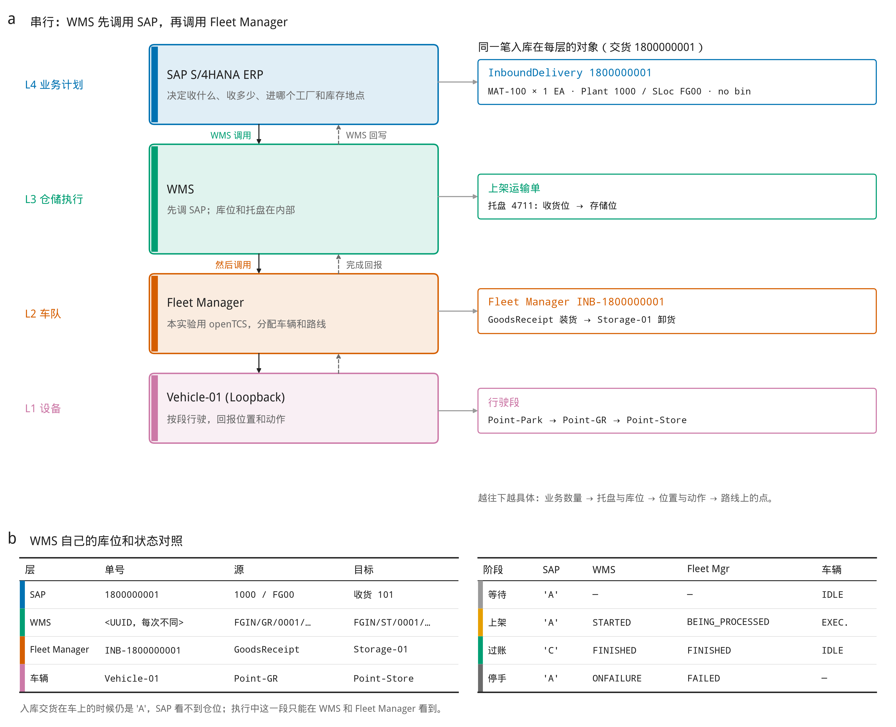

# 整体架构

这条环境看的是一条串行调用：SAP ERP，然后 WMS，然后 Fleet Manager，然后车辆。车辆不真的动。Fleet Manager 这一层本实验用 openTCS 的 Loopback 驱动沿路线走完并回报；Python 简化版用一个小车辆服务做同样的回报。

SAP 在这里是 ERP，不是 EWM。它管物料主数据、工厂、库存地点、入库交货、出库交货和物料凭证。仓位、托盘和上架单都在 WMS 内部，不再另画成一个 WMS。WMS 先直接调用 SAP，内部上架单就绪之后才调用 Fleet Manager。中间没有桥接。

仓库里有两套实现，形状相同：

- 完整版：SAP ERP 的 OData V2 模拟、WMS、Fleet Manager。WMS 内部用 OpenWMS 保存库位和运输单，对外不把它们画成第二个系统。Fleet Manager 本实验用 openTCS。接口细节见 [SAP标准接口.md](SAP标准接口.md)。
- Python 简化版：四个标准库 HTTP 服务，放在 `python-chain` 容器里。WMS 在 `python/chain/wms.py` 里直接调 SAP。接口是简化过的，用来对照状态怎么传，不替代上面的 OData。

调度板 <http://localhost:8080> 把两套画成同样的四个框，从左到右串行：SAP、WMS、Fleet Manager、车辆。框里的文字是该服务当时的返回，不是写死的示例。

## 架构原理

图 4 a 是一条串行链。SAP 决定收什么货。WMS 先向 SAP 取入库交货，库位、托盘和上架单都在 WMS 里面处理。内部单就绪后，WMS 才调用 Fleet Manager。Fleet Manager 分配车辆和路线，车辆只向 Fleet Manager 回报。卸货完成后，WMS 再调用 SAP 过账收货。图 4 b 是单号和状态怎么沿这条链对齐。

图 5 和 `docs/figures/board_snapshot.png` 仍是改成这套架构之前、按 EWM 仓库任务采样的那一次运行，不能用来对照现在的调度板。要重采：先 `docker compose down`，再在仓库根目录执行 `python docs/figures/record_run.py`，然后在 `docs/figures` 里执行 `python make_figures.py`。

## 数据流

调用按这个顺序走完，再原路返回：车辆回报 Fleet Manager，Fleet Manager 回报 WMS，WMS 调用 SAP 过账收货。SAP 不调用 WMS。WMS 内部的库位和托盘不另成一个系统。车辆不认识 SAP。

完整版里，这四块对应的进程和端口是：

| 架构上的一块 | 进程 | 端口 | 跑通时它拿出的结果 |
| --- | --- | --- | --- |
| SAP ERP | `sap`，OData V2 模拟 | 4004 | 入库交货 `1800000001` 状态 `C`，物料凭证 `5000000001`，移动类型 `101` |
| WMS | `wms` 先调用 SAP。库位和运输单在 WMS 内部，由 `openwms-common`、`openwms-tms` 保存 | 8090、8120、8131 | 「上架完成，已在 SAP 过账收货」。运输单 `FINISHED`，托盘在存储位 |
| Fleet Manager | 本实验用 `opentcs` 内核，Web API | 55200 | 订单 `INB-1800000001` 为 `FINISHED` |
| 车辆 | Fleet Manager 里的 Loopback 驱动 `Vehicle-01` | 含在 55200 | 空闲，停在 `Point-Store` |

`common-compat` 没有单独画出来。它在 WMS 内部，夹在 TMS 和 Common 之间：TMS 2.0 查库位组时期待一个对象，Common 3.0 不带名字时返回数组，兼容层取其中一个，否则建运输单会 502。

Python 简化版用同一形状，端口错开：

| 架构上的一块 | 代码 | 端口 | 跑通时它拿出的结果 |
| --- | --- | --- | --- |
| SAP ERP | `python/chain/sap.py` | 9004 | 入库交货 `1800000001` 为 `C`，物料凭证 `5000000001` |
| WMS | `python/chain/wms.py` | 9120 | 运输单 `TO-0001` 为 `FINISHED`，日志是「入库交货 1800000001 上架完成，收货已回写 SAP」 |
| Fleet Manager | `python/chain/fleet.py` | 9200 | 订单 `INB-1800000001` 为 `FINISHED` |
| 车辆 | `python/chain/vehicle.py` | 9300 | 空闲，停在 `Point-Store` |

## 组织和库位

SAP 只有工厂和库存地点。WMS 库位和 Fleet Manager 的位置是另外两套名字，对照写在 WMS 里。

| SAP | WMS 库位 | Fleet Manager 位置 | 路线上的点 | 含义 |
| --- | --- | --- | --- | --- |
| 工厂 `1000` / 库存地点 `FG00` | `FGIN/GR/0001/0000/0000` | `GoodsReceipt` | `Point-GR` | 收货位，WMS 自己定的 |
| 同上 | `FGIN/ST/0001/0000/0000` | `Storage-01` | `Point-Store` | 存储位，上架目标 |

车辆从 `Point-Park` 出发，先到收货位装货，再到存储位卸货。托盘条码是 `00000000000000004711`，类型 `PALLET`。启动时托盘还不存在，WMS 接到交货单后才登记。

货物还在车上的时候，SAP 交货单仍是未过账。ERP 的入库交货没有「执行中」这一个状态：

| 阶段 | SAP 入库交货 | WMS | Fleet Manager |
| --- | --- | --- | --- |
| 等待接手 | 未过账 `A` | | |
| 车辆正在上架 | 未过账 `A` | `STARTED` | `BEING_PROCESSED` |
| 卸货完成并过账 | `C` | `FINISHED` | `FINISHED` |

Fleet Manager 失败时 WMS 不改 SAP，交货单保持 `A`，运输单置为 `ONFAILURE`，然后停手等人处理。

出库交货 `8000000001` 预制在 SAP 里，货物移动状态也是 `A`，移动类型 `601`。可以按 [SAP标准接口.md](SAP标准接口.md) 单独调用 `PostGoodsIssue`。WMS 这一版不自动拣货，避免和入库抢同一辆车，也不把收货位当成发货月台。

## Case：入库交货 1800000001

这是启动后自动跑完的一笔。预制数据在 `sap/server.js` 的 `seed()`。

| 字段 | 值 |
| --- | --- |
| 入库交货 `DeliveryDocument` | `1800000001`，类型 `EL` |
| 供应商 | `V100` |
| 行项目 | `000010` |
| 物料 | `MAT-100`，类型 `HAWA`，1 `EA` |
| 工厂 / 库存地点 | `1000` / `FG00` |
| 采购订单 | `4500000001` / `00010` |
| 启动时货物移动状态 | 未过账 `A` |

OpenWMS 运输单主键在容器重建后会换成新的 UUID。交货单号、托盘、车队订单名每次启动都一样。

### 完整版怎么走完这一笔

1. **主数据。** WMS `GET API_PRODUCT_SRV/A_Product` 和 `A_ProductStorageLocation`，确认 `MAT-100` 和 `1000/FG00` 存在，并建好两个库位。
2. **读交货。** WMS 请求 `GET .../A_InbDeliveryHeader?$filter=OverallGoodsMovementStatus eq 'A'`，拿到 `1800000001`。
3. **上架单。** WMS 在收货位登记托盘 `00000000000000004711`，再创建到存储位的运输单。交货单、运输单和车队订单的对照记在 WMS 自己的 `links` 里。
4. **Fleet Manager。** WMS 内部单就绪后才 `POST /v1/transportOrders/INB-1800000001`。第一段到 `GoodsReceipt` 做 `Load cargo`，第二段到 `Storage-01` 做 `Unload cargo`。
5. **过账。** Fleet Manager 订单变成 `FINISHED` 后，WMS 把自己的运输单改为 `FINISHED`，托盘挪到存储位，再调用 SAP。读交货单拿 ETag，取 CSRF 令牌，调用 `PostGoodsReceipt?DeliveryDocument='1800000001'`。交货单变为 `C`，物料凭证 `5000000001`，行上移动类型 `101`。

要回查这笔货，打开 <http://localhost:8090/status>，在 `links` 里找 `1800000001` 对应的运输单。

### 同一笔在 Python 里

Python 不调用 4004 和 8131。它自己的 SAP 里有一张同号、状态 `A` 的入库交货，WMS 按同样的顺序做：同步主数据，登记托盘，建运输单 `TO-0001`，下发 `INB-1800000001`，走完后过账。物料凭证号同样是 `5000000001`。

### 和调度板怎么对

| 调度板上的框 | 这一笔要看到 |
| --- | --- |
| 两张总览 | 都是「已收货」，托盘都写 `FGIN/ST/0001/0000/0000` |
| SAP | 入库交货 `1800000001`，`MAT-100`，工厂/库存地点 `1000 / FG00`，物料凭证 `5000000001` |
| WMS | 运输单已完成，目标库位是存储位。完整版日志是「上架完成，已在 SAP 过账收货」；Python 是「入库交货 1800000001 上架完成，收货已回写 SAP」 |
| Fleet | 订单 `INB-1800000001`，收货位装货和存储位卸货都已完成 |
| Vehicle-01 | 空闲，位置 `Point-Store` |
| 库区平面 | 停车、收货没有车；两块牌子都在存储 |
| 页脚 | 出库交货 `8000000001` 仍是未过账 |

页面每 2 秒向 `http://localhost:8080/api/snapshot` 要一次这些字段。容器刚启动时完整版的 SAP 会先显示未过账，大约一分钟后变成上表。Python 大约 5 秒。
